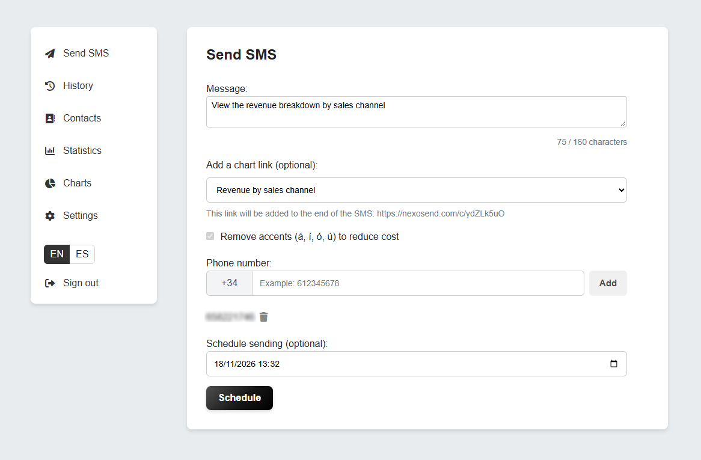
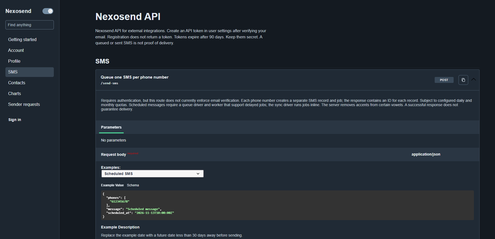

# Nexosend — Project Overview

> **About this repository:** This is a public presentation of Nexosend, not
> the application repository. The Nexosend source code and its development
> repository are private. This overview explains the product, its features
> and its technical design without distributing the application code.

Nexosend is a web application for sending and scheduling SMS messages,
managing contacts, and reviewing message activity. It also provides a REST
API for external integrations.

**[Visit Nexosend](https://nexosend.com)** ·
**[Explore the API documentation](https://nexosend.com/api-docs)**

## Product demo

See how Nexosend handles SMS sending, scheduling, contacts, analytics,
shareable charts and API access.

https://github.com/user-attachments/assets/cf010866-13cd-4e65-9393-9ff78bd8e9b5

## What it does

- **Send SMS:** send a message to one or multiple recipients, with a separate
  record for each number.
- **Schedule messages:** choose a future sending time and cancel an eligible
  scheduled message before it is sent.
- **Manage contacts:** create, update and remove contacts for future messages.
- **Track activity:** review message history, processing statuses and statistics.
- **Share charts:** create charts and share them through a public link that can
  be included in an SMS.
- **Integrate with the API:** use the documented REST endpoints for SMS,
  contacts, charts and selected account features.

## Screenshots

### Sending and scheduling SMS

### SMS statistics

### Sharing charts

### API documentation

## How SMS processing works

1. A user submits a message through the web application or the API.
2. Nexosend validates the request, checks configured usage limits and creates
   an SMS record and a queued job for each recipient.
3. A queue worker processes each job using the configured SMS provider.
   A simulated provider is available for development.
4. The result is recorded in the message history. Some processing errors can
   be retried; a provider rejection is recorded as a failure.

The queue driver is configurable. Background and scheduled processing require
a queue backend and worker that support delayed jobs. A `sent` status reflects
a successful provider response; it does not confirm delivery to the phone.

## Technology

| Area | Technologies |
| --- | --- |
| Backend | PHP, Laravel |
| Frontend | Vue 3, Vite |
| Authentication | Laravel Sanctum, session authentication and API tokens |
| Messaging | Laravel queues and a simulated SMS provider |
| Data and infrastructure | MySQL, optional Redis queue backend, Docker |
| API documentation | OpenAPI and Swagger UI |
| Testing | PHPUnit and Laravel feature tests |
| Continuous integration | GitHub Actions |

The CI workflow runs the Laravel test suite against MySQL and builds the
frontend on pull requests and pushes to the main branch.

## API

The API supports token-based access for external integrations. After verifying
their email, users can create and revoke tokens from the web application.
Tokens expire after 90 days.

The public [API documentation](https://nexosend.com/api-docs) describes the
available endpoints, authentication and example requests and responses.

## Project status

Nexosend is an evolving application. This repository is a public overview,
not an open-source distribution or a deployment guide.

## Contact

For questions about Nexosend, contact
[info@nexosend.com](mailto:info@nexosend.com).
